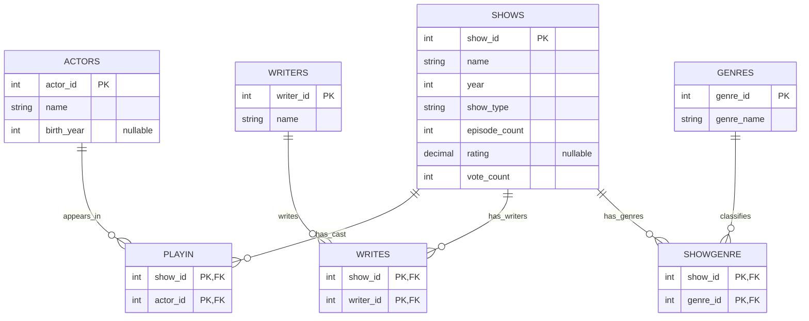

# TV Show Catalog — ER Diagram

`PLAYIN`, `WRITES`, and `SHOWGENRE` are junction tables with composite primary keys:
`(show_id, actor_id)`, `(show_id, writer_id)`, and `(show_id, genre_id)`,
respectively. Each of their columns is also a foreign key to the corresponding
entity.

Assumptions and rules:

1. Actors and writers are separate entities; a person may appear in both.
2. A show can have many actors, writers, and genres, and each can be linked to
   many shows.
3. An unrated show has `rating = NULL` and `vote_count = 0`. Only aggregate
   ratings are stored.
4. Credits and genres may be incomplete. Episodes are stored as a count.