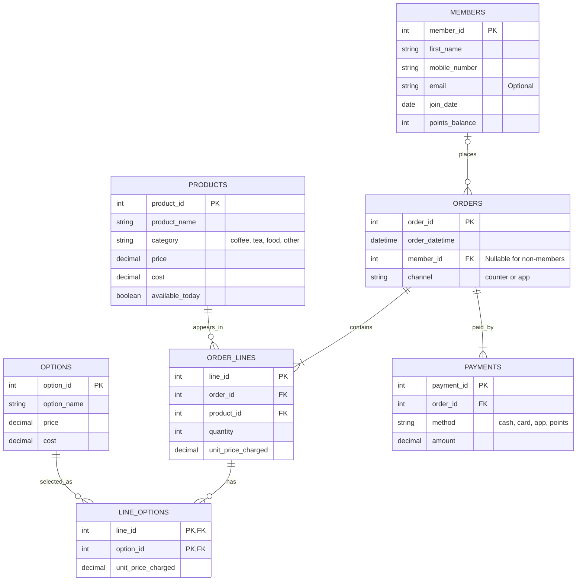

# Babson Bean Café Database Project

## 1. Scenario

I chose Scenario C: Babson Bean Café.

Babson Bean is a campus café that records sales at the till and
manages its loyalty program using punch cards. It needs a database
to connect members, menu products, drink options, orders and payments.

The café wants to understand what sells, which options contribute
to revenue and margin, and who its regular customers are.

## 2. Entity-Relationship Diagram

## 3. What One Row Represents in Each Table

### MEMBERS
One row represents one loyalty member, including their contact information, join date and current points balance.

### PRODUCTS
One row represents one menu product, including its category, current price, cost and availability today.

### OPTIONS
One row represents one add-on, such as oat milk or an extra shot, including its current price and cost.

### ORDERS
One row represents one order, including when it was placed, its channel and the member who placed it, if any.

### ORDER_LINES
One row represents one product within an order, including the quantity purchased and the price charged per unit at the time.

### LINE_OPTIONS
One row represents one option added to one order line, including the price charged for that option per unit of the product.

### PAYMENTS
One row represents one payment toward an order, including its method and dollar amount, even when paid with points.

## 4. Design Choices

### 1. Keys

I chose member_id as the primary key instead of mobile_number.
A member can change their mobile number, while member_id stays
the same and keeps their previous orders connected.
Email is optional, so it is not suitable as the primary key.

### 2. Optional Relationships

An order can have no member because non-members can buy too.
A member can have no orders because joining does not require
a purchase. A product can have no sales. An order line can
have no options, and an option can exist without being selected.

Each order line must belong to exactly one order and one product.
Each line option must belong to exactly one line and one option.
Each payment must belong to exactly one order.

### 3. Rules Checked with Queries

The tables use primary keys, foreign keys, NOT NULL and CHECK
constraints to enforce rules within the database.

These constraints do not ensure that every order has a line
and a payment, or that its payment total equals its order total.
I check those conditions with a query, totaling order lines
and options separately from payments to avoid double-counting.

Transaction records store the prices charged at purchase.
I assume product and option costs remain constant during
the analysis period.

### 4. A Design Detail I Checked

I checked that the ERD allows an order to have zero or one
member and a member to have zero or many orders. This matches
the scenario because non-members can buy, and members can
join without ordering. The nullable member_id in orders
matches the optional member relationship.