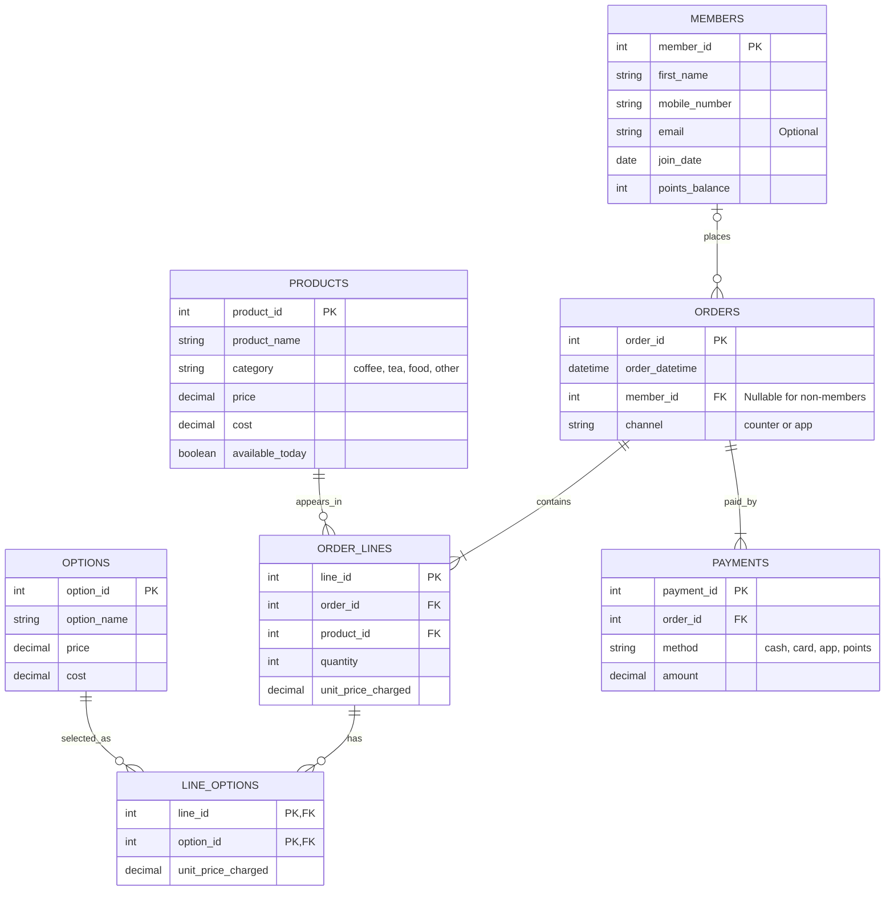

# Babson Bean Café Database Project

## 1. Scenario

I chose Scenario C: Babson Bean Café.

Babson Bean is a campus café that records sales at the till and
manages its loyalty program using punch cards. It needs a database
to connect members, menu products, drink options, orders and payments.

The café wants to understand what sells, which options contribute
to revenue and margin, and who its regular customers are.

## 2. Entity-Relationship Diagram

## 3. What One Row Represents in Each Table

### MEMBERS
One row represents one loyalty member, including their contact information, join date and current points balance.

### PRODUCTS
One row represents one menu product, including its category, current price, cost and availability today.

### OPTIONS
One row represents one add-on, such as oat milk or an extra shot, including its current price and cost.

### ORDERS
One row represents one order, including when it was placed, its channel and the member who placed it, if any.

### ORDER_LINES
One row represents one product within an order, including the quantity purchased and the price charged per unit at the time.

### LINE_OPTIONS
One row represents one option added to one order line, including the price charged for that option per unit of the product.

### PAYMENTS
One row represents one payment toward an order, including its method and dollar amount, even when paid with points.

## 4. Design Choices

### Member Identification
I used member_id as the primary key instead of a mobile number because a member can change their phone number. Their ID stays the same, keeping their previous orders connected to the correct member.

### Non-Member Orders
The member_id in the orders table can be NULL because customers do not need to be loyalty members to place an order.

### Historical Prices
Order lines and line options store the price charged per unit at the time of purchase. This keeps historical revenue accurate even if menu prices change later.

### Options on Order Lines
The line_options table connects order lines with their selected options. Its combined primary key, line_id and option_id, prevents the same option from appearing twice on one line. Option charges are multiplied by the quantity on the order line.

### Multiple Payments
Payments are stored in a separate table because one order can have multiple payments, such as part by card and part with points. All payment amounts are recorded in dollars, including points payments. Revenue is calculated from order lines and options, rather than payment methods.

### Cost Assumption
I assumed that product and option costs remained constant during the analysis period. Costs are stored in the products and options tables, without a separate history of cost changes. Each option's revenue and cost are assigned to the category of the product on its order line.

### Data Rules and Validation
Primary keys identify records, and foreign keys keep related records connected. CHECK constraints enforce rules such as positive quantities, positive payments and product prices that are not below cost. A separate query checks that every order has lines and payments and that its payment total matches its order total. Order totals and payment totals are calculated separately to avoid double-counting.

### Simulated Data
The data generator uses a fixed random seed of 42 and a reference date of November 8, 2026, so its results can be reproduced. It creates 40 members, 20 products, 8 options and 1,000 orders, together with their order lines, selected options and payments. The data includes non-member orders, members who have never ordered, products with no sales, lines without options and orders partly paid with points.